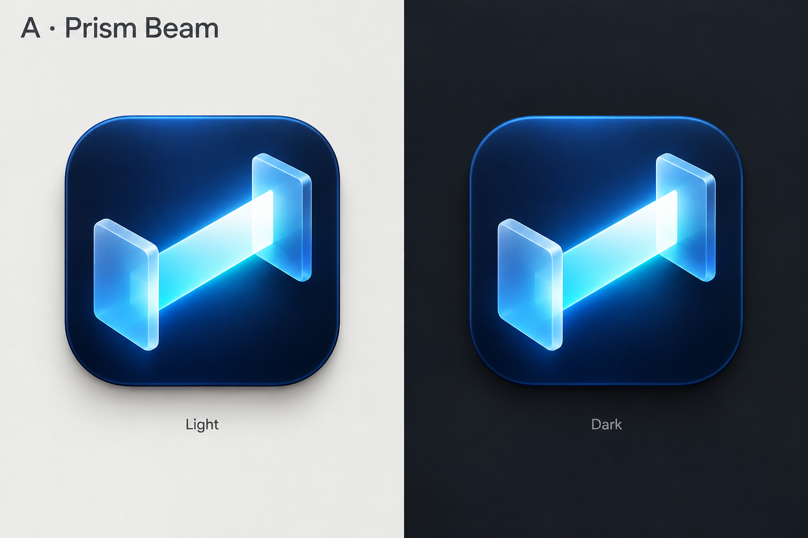
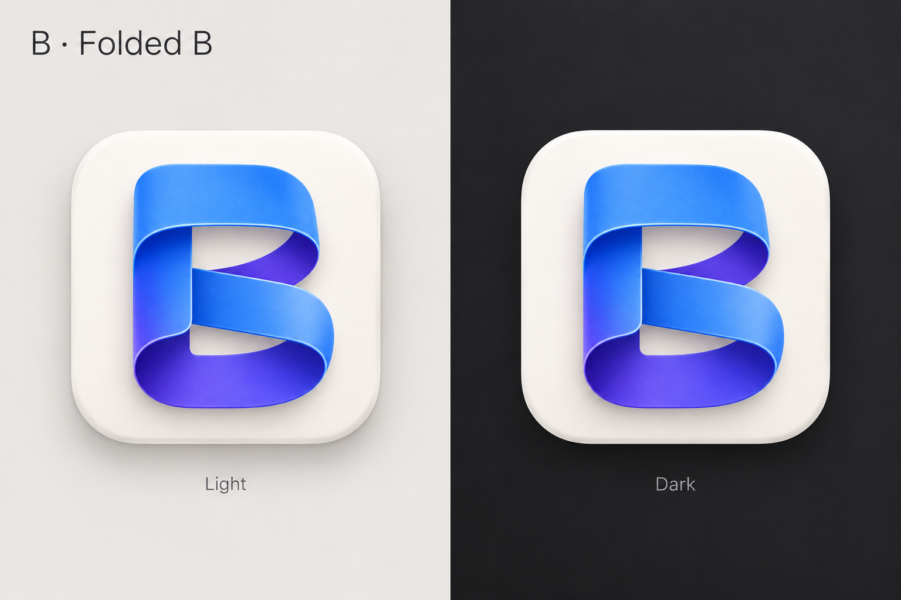
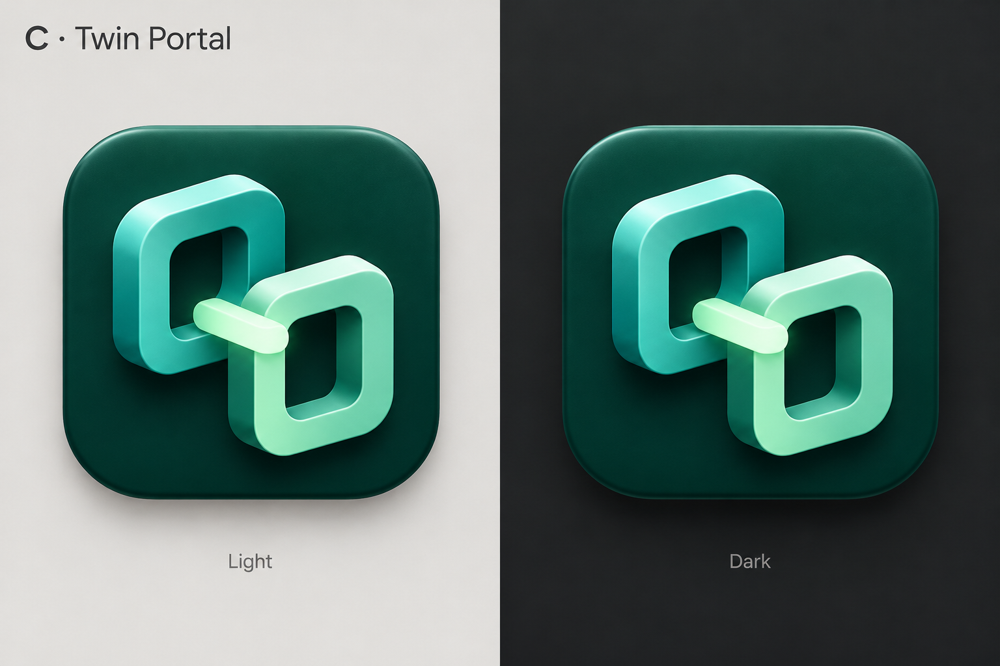

# First app icon exploration (rejected)

Design exploration, 2026-10-17. The user rejected all three directions. Keep these
boards as historical exploration, not candidates for implementation. The panels
compare wallpaper contrast; they do not demonstrate native macOS Default/Dark
icon appearances. See the [macOS icon research](macos-icon-research.md) for the
corrected approach and observations from other apps.

## Current assets

- The macOS [bundle metadata](../../src/desktop/macos/Info.plist.in) has no app icon
  configured. Its [menu-bar item](../../src/desktop/macos/AppDelegate.swift) uses
  the system `arrow.up.arrow.down.circle` symbol.
- The Linux [window and tray](../../src/desktop/qt/window.cpp) draw a simple
  placeholder. The installed [desktop entry](../../cmake/InstallDesktopEntry.cmake.in)
  has no `Icon` field.
- The Android [manifest](../../android/app/src/main/AndroidManifest.xml) and
  [foreground-service notification](../../android/app/src/main/java/org/beam/android/TransferService.kt)
  use Android's built-in `ic_menu_share` symbol.

## A: Prism Beam

A luminous cyan beam joins two blue device-like endpoints on a midnight tile.
The direct connection makes the name and transfer purpose visible. The clear
diagonal is a useful starting point for a small monochrome mark.

Refinement after selection: reduce the glow, simplify the endpoint perspective,
and check that the beam remains distinct at small sizes.

## B: Folded B

A custom blue-to-violet ribbon forms a dimensional B on a porcelain tile. This
direction emphasizes Beam's name and feels friendly alongside native Mac apps.
Its large letter silhouette gives it a straightforward monochrome interpretation.

Refinement after selection: widen the two internal openings and simplify folds
for the smallest sizes. Consider a darker tile for an explicit dark appearance.

## C: Twin Portal

Two mint and teal portals connect across a short bridge on a deep pine tile.
This direction emphasizes paired devices and has a calmer color palette.

Refinement after selection: flatten the perspective and preserve the separation
between the two portals in the monochrome mark.

## Original production plan (superseded)

The following plan records the first exploration. The
[research and revised approach](macos-icon-research.md) supersede its macOS
appearance assumptions.

1. Create editable vector foreground artwork and a separate background using the
   selected direction. Preserve its core silhouette across appearances. The
   presentation-board captions, wallpaper, and cast shadows are not icon assets.
2. Prepare the macOS app icon with default and dark appearance treatments where
   supported, plus a compatible `.icns` fallback for the app's macOS 13+ baseline.
   Check the installed bundle and Dock on both light and dark backgrounds. Use a
   separate simplified monochrome template for the menu-bar item.
3. Reuse the artwork for Linux app/window assets, an installed icon, and the
   launcher's `Icon` entry. Check tray contrast against light and dark panels.
4. Produce Android foreground, opaque background, and monochrome layers. Use
   108 × 108 dp layers with essential artwork within the centered 66 × 66 dp safe
   area. Preview circle and squircle masks, themed light/dark icons, and a
   dedicated monochrome notification icon.
5. Inspect 16, 18, 22, 32, 64, 128, 256, 512, and 1024 pixel app/mark exports at
   their intended sizes; adjust small artwork optically instead of preserving
   every highlight. Verify packaged resources, build/install integration, and
   applicable desktop/Android checks before replacing the current icons.

The boards were created with the built-in imagegen tool. The
[exact prompt set](app-icon-prompts.md) is saved alongside them. No new build or
runtime dependencies were added during this exploration.

## Platform references

- [Apple app icon guidelines](https://developer.apple.com/design/human-interface-guidelines/app-icons/)
  cover layered artwork, consistent appearance variants, and clear silhouettes.
- [Apple Icon Composer](https://developer.apple.com/icon-composer/) provides
  default, dark, and mono appearance previews for supported Apple platforms.
- [Android adaptive icons](https://developer.android.com/develop/ui/compose/system/icon_design_adaptive)
  specify foreground/background/monochrome layers, masks, and safe areas.
